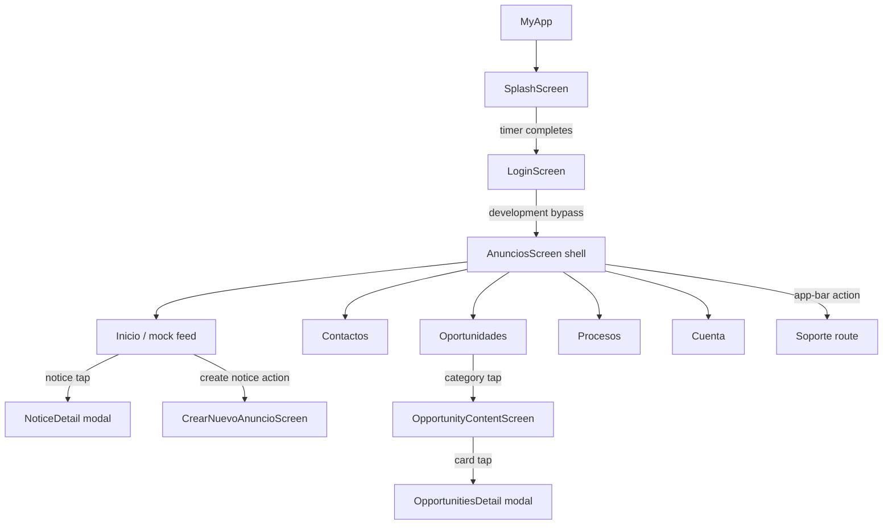
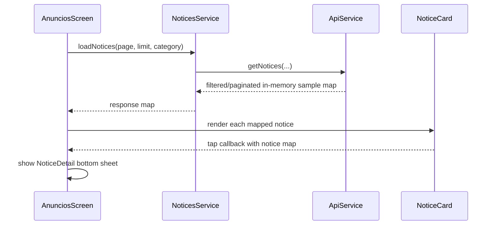

# Frontend navigation and data flows

## Startup and navigation



The responsive navigation treatment may change between a bottom bar and a rail on sufficiently wide windows, but it retains the same five destinations and selected-index behavior. Support stays a separate route.

## Notice list



There is no call from this flow to `backend/routes/noticeRoutes.ts`.

## Creation and attachments

```text
Create notice screen
  -> validate local title/content
  -> optional StorageService picker
  -> simulated delay and mock URL/key
  -> callback to shell
  -> NoticesService creates an item in a newly generated mock-data map
  -> shell reloads feed, which regenerates base sample data
```

This interaction is illustrative rather than persistent. Current bugs around the shared title/link controller, attachment previews, and the transient mock dataset are listed in [Known gaps](known-gaps.md). Opportunity and message screen callbacks are optional and not wired by the home shell.

## Other screens

- Contact search filters local sample records and copy actions call the platform clipboard.
- Opportunity categories come from the asset manifest; content is generated example data backed by bundled sample images.
- Processes and Support render content with placeholder taps.
- Account uses source-defined example profile values and placeholder schedule data. Sign-out navigation does not clear mock auth state.
